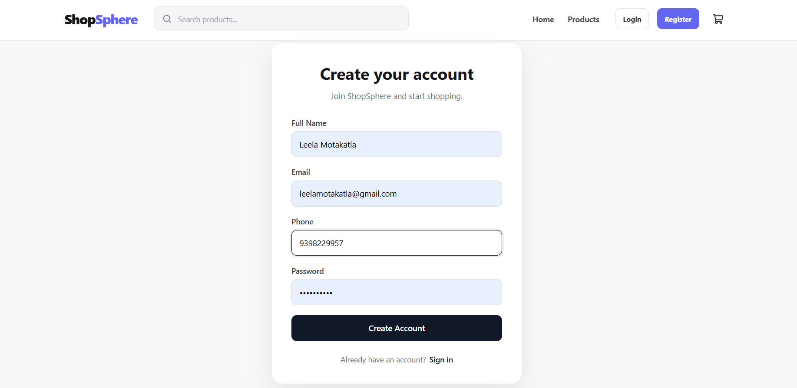
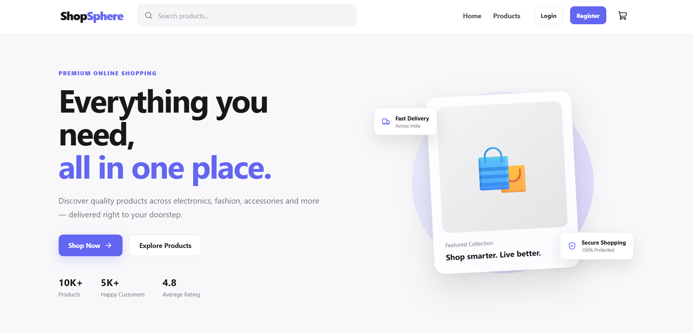
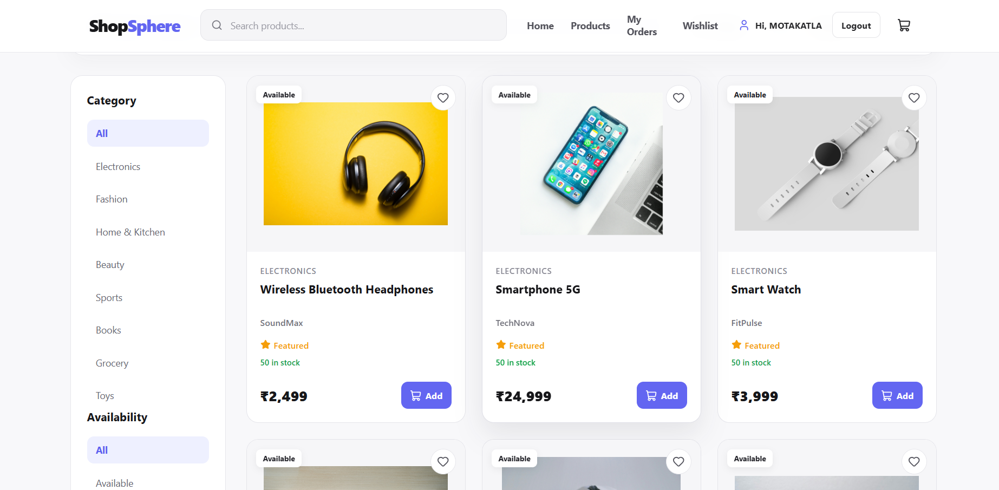
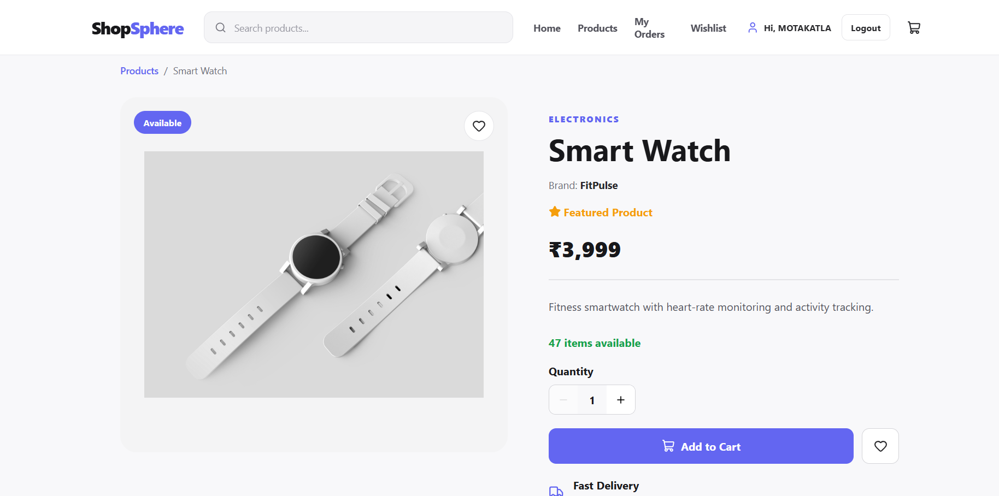
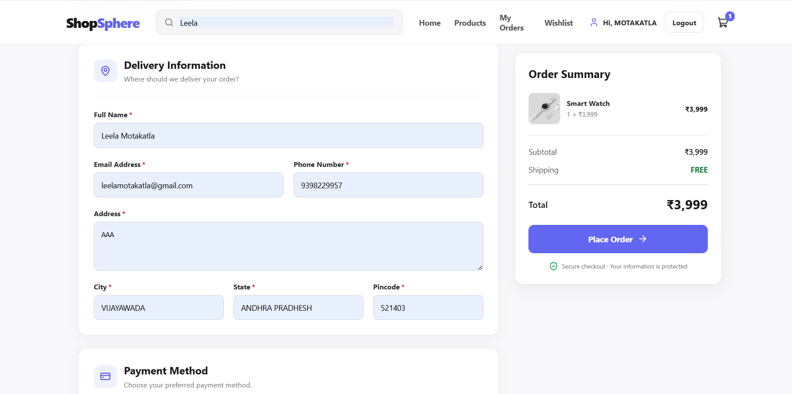
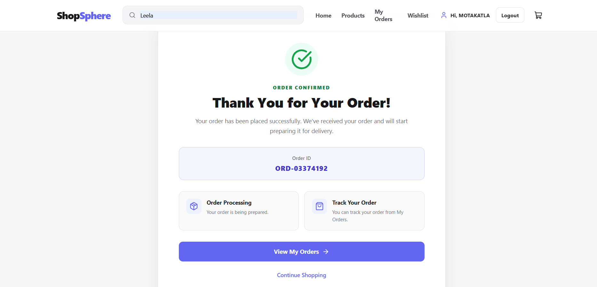
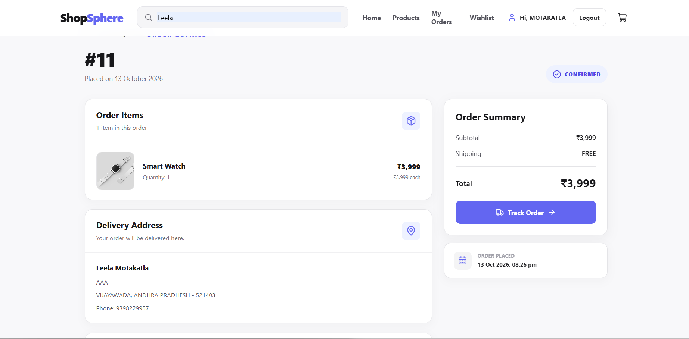
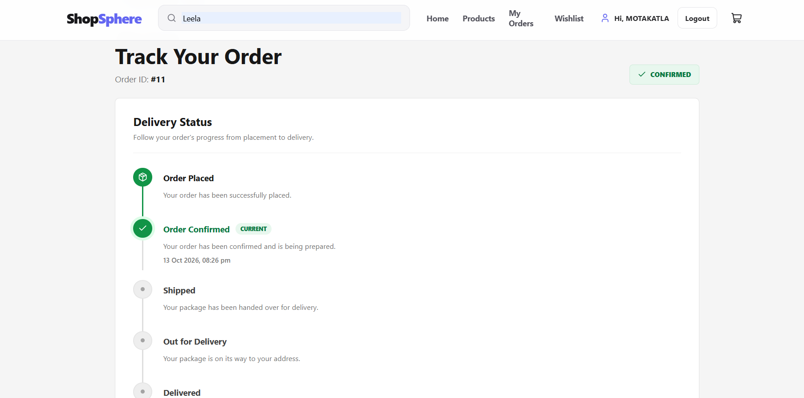

# E-Commerce Order & Inventory Management System

A full-stack e-commerce application built using **Java, Spring Boot, React, and MySQL**. The application supports product browsing, shopping cart management, checkout, order processing, order tracking, and inventory management.

## Key Features

- **Authentication:** User registration and login.
- **Product Browsing:** View available products and product details.
- **Shopping Cart:** Add, remove, and manage products.
- **Checkout:** Place orders through the checkout workflow.
- **Order Management:** View order confirmations and order details.
- **Order Tracking:** Check order status.
- **Inventory Management:** Manage product stock.

## Tech Stack

| Technology | Purpose |
|---|---|
| Java 21 | Backend programming |
| Spring Boot | REST APIs and business logic |
| Spring Data JPA | Database access |
| Hibernate | Object-relational mapping |
| React | Frontend user interface |
| JavaScript, HTML, CSS | Frontend development |
| MySQL | Relational database |
| Maven | Backend build and dependency management |
| npm | Frontend package management |

=======
A full-stack e-commerce application built with **Java, Spring Boot, React, and MySQL**, featuring product browsing, authentication, checkout, and order management.

## Key Features

- User authentication and authorization
- Product listing and product details
- Shopping cart and checkout
- Order placement and confirmation
- Order details and tracking
- MySQL database integration
- RESTful API architecture

## Tech Stack

- **Backend:** Java 21, Spring Boot, Spring Data JPA, Hibernate
- **Frontend:** React, JavaScript, HTML, CSS
- **Database:** MySQL
- **Build Tools:** Maven, npm
- **Version Control:** Git, GitHub


## Project Structure

```text
ecommerce-order-inventory/
├── backend/
│   ├── src/
│   ├── pom.xml
│   └── mvnw.cmd
├── ecommerce-frontend/
│   ├── public/
│   ├── src/
│   ├── package.json
│   └── package-lock.json
├── frontend/
│   └── public/
│       └── images/
├── .gitignore
└── README.md
```

## Screenshots

### 1. Authentication



### 2. Home Page



### 3. Product Listing



### 4. Product Details



### 5. Checkout



### 6. Order Confirmation



### 7. Order Details



### 8. Order Tracking



## Prerequisites

- Java JDK 21
- MySQL Server
- Node.js and npm
- Git

## Getting Started

### 1. Clone the Repository

```bash
git clone https://github.com/leelamotakatla-08/ecommerce-order-inventory.git
cd ecommerce-order-inventory
```

### 2. Configure MySQL


Create a MySQL database and configure the database URL, username, and password in the appropriate configuration file under `backend/src/main/resources/`.
>>>>>>> 714a14f (docs: update project README and screenshots)

Keep database credentials and secrets out of version control.

Configure the database URL, username, and password in the appropriate configuration file under `backend/src/main/resources/`.

Ensure that MySQL is running and the database settings match your application configuration. Do not commit database credentials or secrets to GitHub.


### 3. Run the Backend

Open a terminal in the repository root:


```powershell
cd backend
.\mvnw.cmd spring-boot:run
```

The backend runs at `http://localhost:8080` by default, unless configured otherwise.

### 4. Run the Frontend


Open a separate terminal in the repository root:


```bash
cd ecommerce-frontend
npm install
npm run dev
```

Open the local URL displayed in the terminal to access the application.

Ensure the frontend API configuration points to the running backend.

## Future Enhancements

<<<<<<< HEAD
- **Payment Gateway Integration:** Support secure online payments and transaction verification.
- **Advanced Inventory Management:** Add low-stock alerts and inventory movement history.
- **Admin Dashboard:** Manage products, categories, users, orders, and inventory.
- **Email Notifications:** Send order confirmations and shipping updates.
- **Order Cancellation and Returns:** Support cancellations, returns, and refunds.
- **Performance Optimization:** Introduce Redis caching and optimize database queries.
- **Deployment and CI/CD:** Deploy to a cloud platform and automate builds and testing.


## Author

**Motakatla Leela Vardhini**

B.Tech — Computer Science and Engineering


